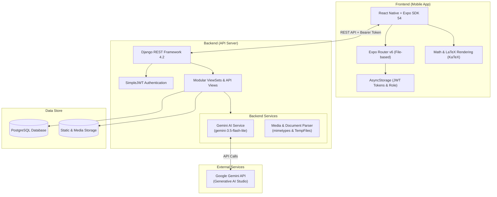

# Guruku.AI 🎓🤖
> **Smart Learning Management System & AI-Powered Personal Tutor Platform**

[](https://www.python.org/)
[](https://www.djangoproject.com/)
[](https://reactnative.dev/)
[](https://expo.dev/)
[](https://aistudio.google.com/)
[]()

---

## 📌 Tentang Guruku.AI

**Guruku.AI** adalah ekosistem pembelajaran pintar berbasis mobile dan cloud yang dirancang untuk menjembatani interaksi antara **Siswa**, **Guru**, dan **Administrator**. Mengintegrasikan model kecerdasan buatan mutakhir (**Google Gemini 3.5 Flash Lite**), Guruku.AI memfasilitasi pembuatan materi otomatis, ekstraksi soal kuis pintar, tutor pribadi dengan metode interaktif Sokratik (Socratic Method), serta rendering rumus matematika kompleks menggunakan format LaTeX/KaTeX.

---

## 🏛️ Arsitektur Sistem



---

## 🚀 Fitur Unggulan

### 1. 👥 Multi-Role & Sistem Verifikasi Akun
- **Siswa (`student`)**: Masuk kelas via kode undangan unik, mengakses materi pelajaran, latihan kuis dengan pembatasan percobaan (*attempt limits*), melihat riwayat nilai, dan berdiskusi dengan AI.
- **Guru (`teacher`)**: Membuat dan mengelola kelas, mengunggah materi pelajaran/video, membuat kuis secara manual atau otomatis via AI, serta memantau nilai dan rekap pengerjaan siswa.
- **Admin (`admin`)**: Panel administrasi untuk memverifikasi keabsahan data Guru (NIP/Mata Pelajaran) dan Siswa (NISN/Tingkat Kelas), melihat statistik platform, dan menyiarkan pengumuman sistem (*system announcements*).

### 2. 🪄 AI Lesson Module Generator
Guru cukup mengunggah berkas modul atau dokumen (PDF/Word), dan Gemini AI akan secara otomatis mengekstraksi, merangkum, serta memformatnya menjadi modul pembelajaran lengkap berformat Markdown dengan rumus matematika LaTeX dan latihan soal singkat.

### 3. 📝 AI Quiz Generator
Guru dapat membuat kuis pilihan ganda secara instan dari dokumen yang diunggah. AI mendeteksi soal dan kunci jawaban yang ada dalam berkas, atau menghasilkan soal baru yang relevan dengan output JSON terstruktur.

### 4. 💬 Chatbot Tutor Pribadi (Socratic AI)
Asisten belajar 24/7 yang berperan sebagai guru privat yang sabar dan ramah. Menggunakan instruksi khusus (*system instructions*) agar:
- Membimbing siswa langkah demi langkah (*step-by-step guidance*) tanpa langsung membocorkan jawaban akhir.
- Mendukung penulisan rumus matematika LaTeX `$$...$$` yang dirender presisi di aplikasi.
- Membatasi percakapan strictly pada ranah kurikulum pendidikan SMP & SMA.

### 5. 📊 Penilaian & Pelacakan Progres Otomatis
- Pelacakan progres belajar siswa (*completed materials*).
- Penghitungan skor kuis otomatis secara transaksional di backend.
- Riwayat skor dan review percobaan siswa.

---

## 📂 Struktur Repositori

```text
Guruku-AI/
├── README.md                      # Dokumentasi Utama Proyek
│
├── guruku-backend/                # Backend API (Django & DRF)
│   ├── api/                       # Sub-aplikasi modular
│   │   ├── admin_panel/           # Endpoint & logika verifikasi admin
│   │   ├── chatbot/               # Socratic AI chatbot & Gemini Service
│   │   ├── classes/               # Manajemen kelas & pengumuman
│   │   ├── materials/             # Materi, video, & AI content generator
│   │   ├── quizzes/               # Kuis, soal, penilaian, & AI quiz maker
│   │   └── users/                 # Custom User, JWT auth, & profil
│   ├── config/                    # Django project settings & URLs
│   ├── media/                     # Direktori upload berkas & profil
│   ├── .env.example               # Contoh konfigurasi environment backend
│   ├── build.sh                   # Deployment build script
│   ├── data.json                  # Database fixtures / initial seed data
│   ├── manage.py                  # Django CLI entrypoint
│   ├── requirements.txt           # Dependensi Python
│   ├── API_DOCUMENTATION.md       # Dokumentasi API Lengkap
│   └── README.md                  # Panduan Teknis Backend
│
└── guruku-frontend/               # Frontend Mobile App (React Native & Expo)
    ├── app/                       # Expo Router file-based routing
    │   ├── (tabs)/                # Tab navigation (Students & Teachers)
    │   ├── Chatbot/               # Halaman antarmuka Socratic AI Chatbot
    │   ├── JoinKelas/             # Halaman bergabung ke kelas via kode
    │   ├── Login/                 # Halaman autentikasi login
    │   ├── Register/              # Halaman registrasi siswa/guru
    │   ├── admin/                 # Panel dashboard administrator
    │   └── role_guard.ts          # Proteksi rute berbasis role & status verifikasi
    ├── assets/                    # Gambar, ikon, dan aset visual
    ├── components/                # Komponen reusable (MathRenderer, Cards, dll)
    ├── constants/                 # Konstanta gaya & tema
    ├── hooks/                     # Custom React Hooks
    ├── services/                  # Integrasi API client Axios & storage
    ├── .env.example               # Contoh konfigurasi environment frontend
    ├── app.json                   # Konfigurasi aplikasi Expo
    ├── eas.json                   # Konfigurasi EAS Build (APK / Production)
    ├── package.json               # Dependensi Node.js / React Native
    └── README.md                  # Panduan Teknis Frontend
```

---

## ⚡ Panduan Cepat Menjalankan Proyek

### Prasyarat
- **Node.js** (v18 atau lebih baru) & **npm**
- **Python** (v3.10 atau v3.11 disarankan)
- **PostgreSQL** (atau MySQL/SQLite)
- **Expo Go** pada perangkat fisik Android/iOS, atau Android Studio Emulator
- **Google Gemini API Key** ([Dapatkan di Google AI Studio](https://aistudio.google.com/))

---

### 1. Menjalankan Backend (`guruku-backend`)

1. **Masuk ke folder backend**:
   ```bash
   cd guruku-backend
   ```

2. **Buat dan aktifkan Virtual Environment**:
   ```bash
   # Windows:
   python -m venv venv
   venv\Scripts\activate

   # Linux / macOS:
   python3 -m venv venv
   source venv/bin/activate
   ```

3. **Install dependensi**:
   ```bash
   pip install -r requirements.txt
   ```

4. **Konfigurasi Environment**:
   Salin `.env.example` menjadi `.env` lalu sesuaikan kredensial:
   ```bash
   copy .env.example .env   # Di Windows CMD
   # atau
   cp .env.example .env     # Di Linux / Mac / PowerShell
   ```
   Isi konfigurasi database dan `GEMINI_API_KEY`.

5. **Migrasi Database & Muat Data Awal (Opsional)**:
   ```bash
   python manage.py makemigrations
   python manage.py migrate
   python manage.py loaddata data.json
   ```

6. **Buat Superuser (Admin)**:
   ```bash
   python manage.py createsuperuser
   ```

7. **Jalankan Server Backend**:
   ```bash
   python manage.py runserver 0.0.0.0:8000
   ```
   API akan berjalan di `http://127.0.0.1:8000/api/`.

---

### 2. Menjalankan Frontend (`guruku-frontend`)

1. **Buka terminal baru dan masuk ke folder frontend**:
   ```bash
   cd guruku-frontend
   ```

2. **Install dependensi**:
   ```bash
   npm install
   ```

3. **Konfigurasi Environment**:
   Salin `.env.example` menjadi `.env`:
   ```bash
   copy .env.example .env   # Di Windows CMD
   # atau
   cp .env.example .env     # Di Linux / Mac / PowerShell
   ```
   Sesuaikan `EXPO_PUBLIC_API_URL`:
   - **Emulator Android**: `http://10.0.2.2:8000/api`
   - **Web / iOS Simulator**: `http://localhost:8000/api`
   - **Perangkat Fisik**: `http://<IP_LAN_KOMPUTER>:8000/api` atau URL ngrok.

4. **Jalankan Aplikasi Expo**:
   ```bash
   npx expo start
   ```
   - Tekan `a` untuk membuka di Emulator Android.
   - Tekan `w` untuk membuka di Web Browser.
   - Pindai QR Code dengan aplikasi **Expo Go** di HP Anda.

---

## 🛠️ Stack Teknologi

| Komponen | Teknologi | Keterangan |
| :--- | :--- | :--- |
| **Mobile Frontend** | React Native 0.81, React 19, TypeScript | Framework utama cross-platform mobile |
| **Framework & Router** | Expo SDK 54, Expo Router v6 | File-based routing & universal runtime |
| **Math & Content Rendering** | KaTeX, react-native-katex, react-native-markdown-display | Rendering presisi Markdown & rumus LaTeX |
| **Backend Framework** | Django 4.2 LTS, Django REST Framework | RESTful API server dengan modular apps |
| **Authentication** | SimpleJWT (JSON Web Token) | Stateless authentication dengan token refresh & access |
| **Database** | PostgreSQL / MySQL | Relational Database Management System |
| **Artificial Intelligence** | Google Gemini 2.5 Flash Lite (`google-generativeai`) | LLM cerdas berlatensi rendah untuk konten, kuis, dan chatbot |
| **Static & Media Delivery** | WhiteNoise, Django Storage | Pengelolaan aset statis dan berkas media |

---

## 📖 Dokumentasi Lanjutan

Untuk membaca panduan teknis yang lebih mendalam, silakan baca dokumentasi masing-masing bagian:
- 📘 [Dokumentasi Lengkap Backend (guruku-backend/README.md)](file:///d:/Data%20Mahasiswa%20Andika%20Bahari%20Maskar/MATKUL/SEMESTER%207/PROJECT%20GURUKU-AI/Guruku-AI/guruku-backend/README.md)
- 📋 [Dokumentasi API Reference Lengkap (guruku-backend/API_DOCUMENTATION.md)](file:///d:/Data%20Mahasiswa%20Andika%20Bahari%20Maskar/MATKUL/SEMESTER%207/PROJECT%20GURUKU-AI/Guruku-AI/guruku-backend/API_DOCUMENTATION.md)
- 📱 [Dokumentasi Lengkap Frontend (guruku-frontend/README.md)](file:///d:/Data%20Mahasiswa%20Andika%20Bahari%20Maskar/MATKUL/SEMESTER%207/PROJECT%20GURUKU-AI/Guruku-AI/guruku-frontend/README.md)

---

## 👨‍💻 Kontributor & Lisensi
Dikembangkan oleh **Andika Bahari Maskar** sebagai proyek edukasi berbasis kecerdasan buatan.  
Didistribusikan di bawah lisensi MIT.
